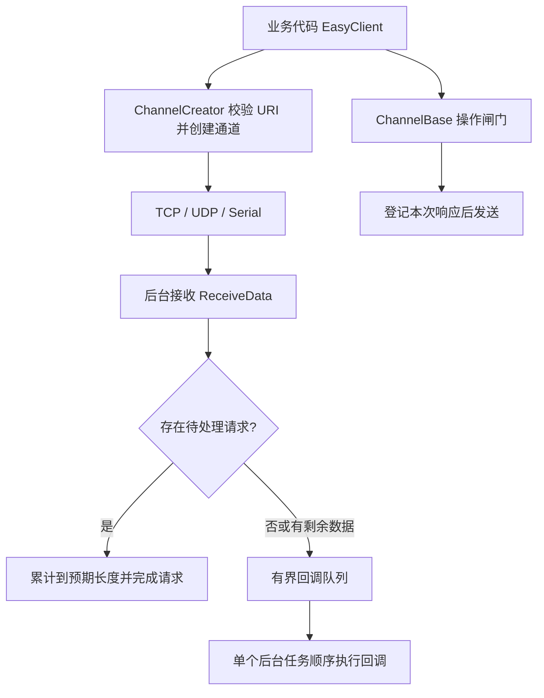

# 项目结构与使用指南

更新日期：2026-11-02。本文描述当前实现；主库和测试项目均以 net10.0 为目标。

## 1. 项目解决什么问题

EasyClient 将 TCP、UDP、串口包装成相同的发送和请求响应接口，适合上位机与仪器之间的命令交互。它负责连接、字节收发、串行调度、超时和资源释放。

它不负责协议解析：设备地址、CRC、报文 ID、主动上报识别、可变长度帧和迟到响应关联，仍由上层协议处理。指定预期长度仅表示“累计多少字节完成”，并不验证字节是否属于当前命令。

## 2. 文件结构与阅读顺序

```text
IFactory.Interaction.EasyClient.slnx       解决方案
IFactory.Interaction.EasyClient/          主库（net10.0）
  IEasyClient.cs / EasyClient.cs          推荐业务入口，代理发送、管理重置和关闭
  IChannel.cs / ChannelBase.cs            通道契约、操作锁、响应累计、回调队列
  IChannelCreator.cs / ChannelCreator.cs  URI 验证与通道工厂
  ChannelOptions.cs                      内部 URI、端点和数值边界校验
  TcpClientChannel.cs                    后台连接/接收、重连、分块发送
  UdpChannel.cs                          绑定本地端点、远端来源过滤
  SerialIOChannel.cs                     串口打开、后台接收、写超时
  SerialIOEndPoint.cs                    串口参数解析
  SerialWriteOperation.cs                写任务与取消回调的时序协调
  Properties/AssemblyInfo.cs             允许测试访问内部实现
IFactory.Interaction.EasyClient.Tests/    单元和本机集成测试（net10.0）
  UnitTest1.cs                           ChannelTests：请求时序和分片等
  OptionsTests.cs                        配置解析及 UDP 基本收发
  SchedulingTests.cs                     调度、取消、回调顺序、生命周期竞争
  BoundaryTests.cs                       溢出、旧连接数据、空 UDP 等
  HandoverTests.cs                       写取消、后台恢复、诊断、内存边界
  PublicApiTests.cs                      对外重载、UTF-8、回调异常和故障恢复
  SerialIntegrationTests.cs              VSPD 串口实测（显式启用）
.github/workflows/test.yml               Windows CI：构建、非串口测试、覆盖率附件
TestResults/                            本地覆盖率产物，已被 Git 忽略
```

建议先看 EasyClient → ChannelBase → 具体通道 → 对应测试。接口中有默认实现，供外部自定义实现保持兼容；内置类会提供真实诊断数据。

## 3. 收发和生命周期模型



- 每个通道的普通发送和请求响应共用操作闸门；请求等待响应时，普通发送也需要排队。
- 响应等待在发送前登记，避免极快响应被误当主动上报。
- 预期长度大于 0 时累计分片；超过长度的剩余字节走主动数据回调。
- 预期长度为 0 时，第一次接收的数据块就完成请求。TCP 的一次读取不是协议帧，正式协议建议指定长度或自行组帧。
- 超时覆盖排队、发送和响应等待；-1 表示没有总超时。取消不能撤回已经发送的字节。
- 回调按接收顺序执行；慢回调会阻塞后续回调，避免在其中执行长时间计算或等待另一个主动回调。
- 重置与关闭互斥。重置关闭旧通道后创建新通道；非法配置在关闭旧通道前被拒绝。运行时打开失败通过 LastResetError 报告，可以排除故障后再次重置。
- CloseAsync 永久关闭当前 EasyClient；需重新打开时创建新的 EasyClient。ResetChannelAsync 用于尚未主动关闭的客户端。

## 4. URI 与资源边界

端点只接受字面 IP，不解析域名。参数名不区分大小写，值进行 URI 解码；重复键或没有等号的参数会失败。保留历史拼写 `ReceiceBuffer`。

| 通道 | 示例 | 含义 |
|---|---|---|
| TCP | `tcp://127.0.0.1:9000/?ReceiceBuffer=6144` | 连接仪器的 IP 和端口 |
| UDP | `udp://127.0.0.1:0/?RemoteEndPoint=127.0.0.1:9001` | 本地绑定 0 表示系统分配端口；RemoteEndPoint 为目标 |
| 串口 | `sio://COM1/?BaudRate=115200&DataBits=8&Parity=None&StopBits=One` | 打开本地串口 |

TCP 可选 `ReconnectInitialMs`（默认 200）和 `ReconnectMaxMs`（默认 10000），范围 1..60000，最大值不能小于初始值。失败时指数退避并加入抖动，连接成功后重新计数。

| 串口参数 | 默认/规则 |
|---|---|
| BaudRate | 必填，正整数 |
| DataBits | 默认 8，范围 5..8 |
| Parity | 默认 None，允许合法枚举名和枚举数字 |
| StopBits | 默认 One；不允许 None，允许合法枚举数字 |
| RtsEnable / DtrEnable | 默认 false |
| WriteTimeout | 默认 -1；允许 -1 或正毫秒数。公开配置属性历史拼写为 WirteTimeout，URI 键为 WriteTimeout |

配置在打开时生效，修改 SioEndPoint 对象不会重新配置已打开串口。写超时使用打开时快照；更换配置请 ResetChannelAsync(newUri)。

| 资源 | 当前契约 |
|---|---|
| ReceiceBuffer | 1..1MiB，默认 6144；TCP 为单次读取空间，UDP 为接受的最大报文 |
| 回调队列 | 最多 256 块且累计负载不超过 4MiB（不含正在执行的回调） |
| 预期响应长度 | 0..16MiB；初始响应容量最多 64KiB |
| TCP 单次底层写 | 最多 64KiB，循环处理部分发送 |
| 串口驱动接收缓存 | 64KiB；单次读取空间为 6144 |

回调队列超限会记录 LastError 并使当前连接失败，不会静默丢字节后继续解析。TCP 随后重连，串口/UDP 需要重置。UDP 超过接受大小的单个报文被丢弃并记录日志，通道继续工作；来源必须与配置远端完全匹配。

## 5. 使用示例

### TCP 请求响应

TCP 构造函数启动后台连接，返回时不保证已经连接。以下示例等待连接，且限制等待时间。示例命令/响应长度仅作展示，应换为仪器协议。

```csharp
using IFactory.Interaction.EasyClient;

await using var client = new EasyClient("tcp://127.0.0.1:9000");
using var cancellation = new CancellationTokenSource(TimeSpan.FromSeconds(5));
while (!client.Channel.IsConnected)
    await Task.Delay(20, cancellation.Token);

ReadOnlyMemory<byte> command = new byte[] { 0x01, 0x02 };
List<byte> response = await client.SendReceiveAsync(
    command, millisecondsTimeout: 2000, expectReceiveLength: 4,
    cancellationToken: cancellation.Token);
Console.WriteLine(Convert.ToHexString(response.ToArray()));
```

### 串口与字符串

```csharp
await using var serial = new EasyClient(
    "sio://COM1/?BaudRate=115200&Parity=None&StopBits=One&WriteTimeout=2000");
// 字符串固定使用 UTF-8；预期长度按字节计算，不按字符计算。
string reply = await serial.SendReceiveAsync("PING\r\n", 2000, 6);
```

### UDP 与主动数据

```csharp
await using var udp = new UdpChannel(
    "udp://127.0.0.1:0/?RemoteEndPoint=127.0.0.1:9001");
udp.DataReceiceHandler = bytes =>
    Console.WriteLine(Convert.ToHexString(bytes.ToArray()));
Console.WriteLine($"实际绑定地址：{udp.LocalEndPoint}");
await udp.SendAsync(new byte[] { 0x01 });
// 通道需在接收期间保持打开。实际程序在此等待业务结束，而不是立即退出作用域。
```

同样可通过 `EasyClient.DataReceiceHandler` 订阅主动数据。不要同时把同一协议响应交给主动回调和请求响应两套解析器。

### 日志、诊断与错误处理

```csharp
try
{
    await client.SendReceiveAsync(command, 2000, 4, cancellation.Token);
}
catch (TimeoutException)
{
    // 排队、发送或响应超时。根据协议决定是否允许重试。
}
catch (OperationCanceledException)
{
    // 业务主动取消或关闭引起的取消。
}
catch (IOException)
{
    // 通道故障。检查 LastError、连接状态和设备侧状态。
}
```

TCP 原生故障还可能直接抛 SocketException；已关闭对象抛 ObjectDisposedException；参数非法抛 ArgumentException 或其子类。不要自动重试会产生不可重复副作用的命令。

`client.Channel.Logger = yourLogger` 可接入 Microsoft.Extensions.Logging。诊断字段：

- IsConnected：当前通道状态。UDP 的 true 表示本地通道可用，不代表远端在线。
- IsClosed：TCP 暂时断线时保持 false（会重连）；主动关闭或终止故障后为 true。串口/UDP 接收故障后关闭。
- LastError / ErrorTimestamp：最近一次历史错误，不会因 TCP 恢复就清除。
- DroppedChunks / DroppedBytes：无订阅者时忽略的主动数据，不计关闭期间丢弃。
- UdpChannel.RejectedSourceDatagrams：来源不匹配的 UDP 报文数。
- EasyClient.LastResetError：最近一次重置失败，重置成功后清除。

### 重置和释放

```csharp
await client.ResetChannelAsync();                // 使用原 URI 重建通道
await client.ResetChannelAsync("tcp://127.0.0.1:9002");
await client.CloseAsync();                       // 此后不能 Reset 或发送
// 推荐 await using，离开作用域自动异步关闭。
```

重置创建新通道，直接设置在旧 Channel 上的 Logger 或回调需要重新应用。EasyClient 自己的 DataReceiceHandler 会继续转发。

## 6. 扩展方式

- 自定义 ChannelBase：实现 SendCoreAsync(data, token) 和 CloseAsync；及时响应 token；接收数据传给 ReceiveData；故障必须调用 FailPendingResponse(error)，不能把半截响应当成功。
- 自定义 IChannelCreator：实现 CreateChannel，并可实现 Validate。在重置关闭旧通道前先校验；默认 Validate 不做处理，允许自定义 URI。
- 外部不能修改 IsConnected、IsClosed 或 Uri；派生类使用 protected setter 管理真实状态。
- 原有同步、string、List 入口保留。同步方法会阻塞调用线程，UI 使用 async。
- List 发送会制作一次快照；Memory 入口不复制调用方数据，操作完成前不得修改底层内存。

## 7. 构建、测试和常见问题

需要 .NET 10 SDK。目标框架和 NuGet 版本集中在 Directory.Build.props 管理；Directory.Build.targets 在项目引用定义后应用 PackageReference Update。System.IO.Ports 与 Logging.Abstractions 已升级至 10.0.14，并通过全套回归测试。

```powershell
dotnet restore IFactory.Interaction.EasyClient.slnx
dotnet build IFactory.Interaction.EasyClient.slnx -c Release -warnaserror
dotnet test IFactory.Interaction.EasyClient.slnx -c Release --filter 'Category!=SerialIntegration'
```

串口集成：提前配置 VSPD COM1↔COM2，保证没有其他程序占用端口。

```powershell
$env:EASYCLIENT_SERIAL_TESTS = '1'
# 可选：EASYCLIENT_SERIAL_A / EASYCLIENT_SERIAL_B 替换默认端口。
dotnet test IFactory.Interaction.EasyClient.slnx -c Release --collect:'XPlat Code Coverage'
Remove-Item Env:EASYCLIENT_SERIAL_TESTS
```

| 现象 | 优先检查 |
|---|---|
| TCP 刚创建就发送失败 | 是否尚未连接；IsConnected、端口和 LastError |
| 请求返回不足一帧 | 是否把 expectReceiveLength 设成了 0；是否正确按字节计算 |
| 收到响应却超时 | 是否是迟到响应、主动上报、长度错误；UDP 来源端口是否匹配 |
| 串口拒绝访问 | 是否被其他程序占用；VSPD 配对是否存在；驱动释放需要时间 |
| 写取消后串口关闭 | 底层写尚未完成时保守中断，需重置；已发送命令是否允许重试 |
| 大量主动数据后断线 | 回调是否过慢、是否达到队列块数或字节限制 |

更多测试数据、已覆盖场景和仍需验证的硬件路径见 TEST-COVERAGE.md。历史交接文件保留供追溯，不作为当前 TFM 或行为的唯一依据。


## 集中构建与 NuGet 版本

`Directory.Build.props` 保存 `TargetFramework=net10.0`、语言版本和各 NuGet 版本属性。`Directory.Build.targets` 在项目的 PackageReference 声明完成后用 Update 应用版本；项目 csproj 只声明包名及项目特有元数据。不要把 Update 直接放在过早导入的 props 顶层。

2026-11-02 查询 NuGet 最新稳定版并验证：Logging.Abstractions / System.IO.Ports 10.0.14，coverlet.collector 10.1.0，Microsoft.NET.Test.Sdk 18.11.0，xunit 2.9.3，xunit.runner.visualstudio 4.0.1。xunit 包名和框架保持 v2，不自动迁移到另一包名的 v3。

检查更新：`dotnet list IFactory.Interaction.EasyClient.slnx package --outdated`。修改版本后执行 restore、零警告构建及完整测试，串口相关依赖需启用 VSPD 测试。固定版本便于复现，不使用浮动版本。
